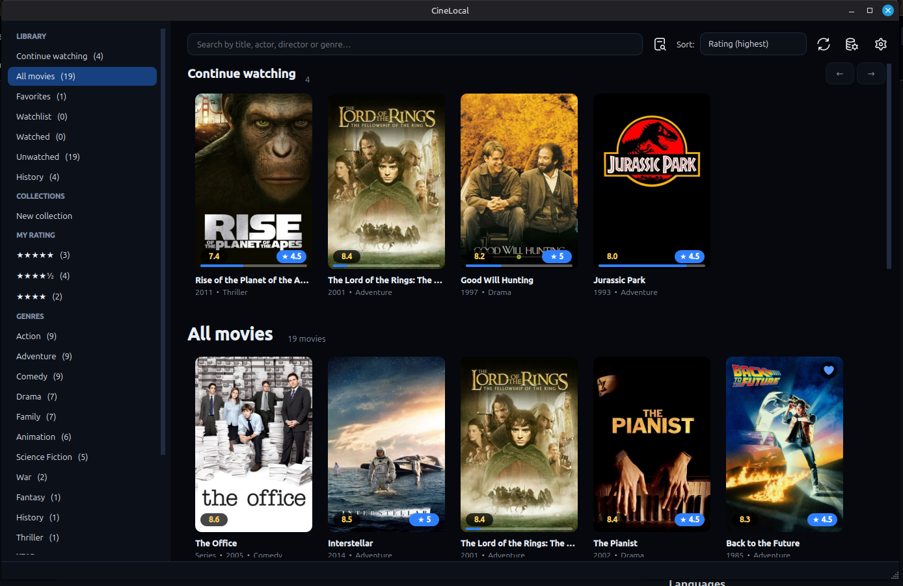
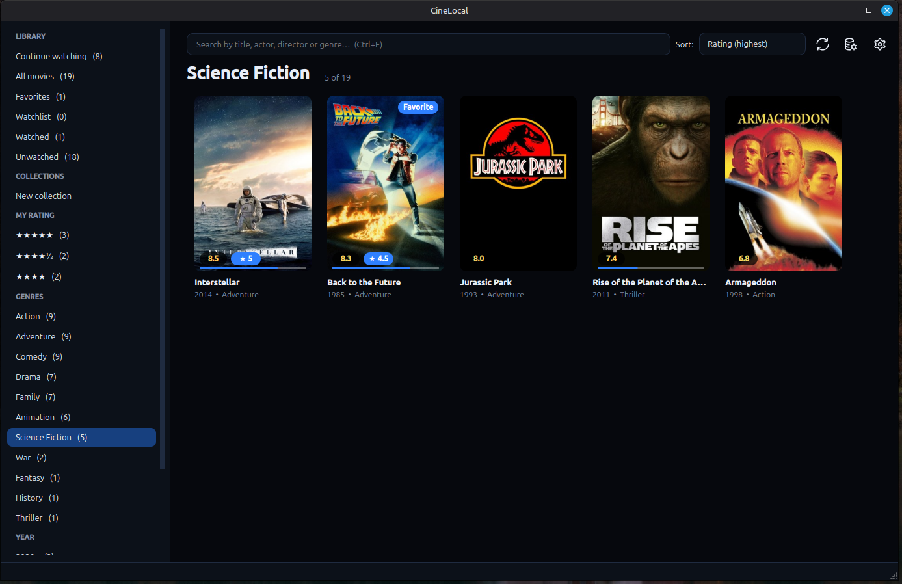
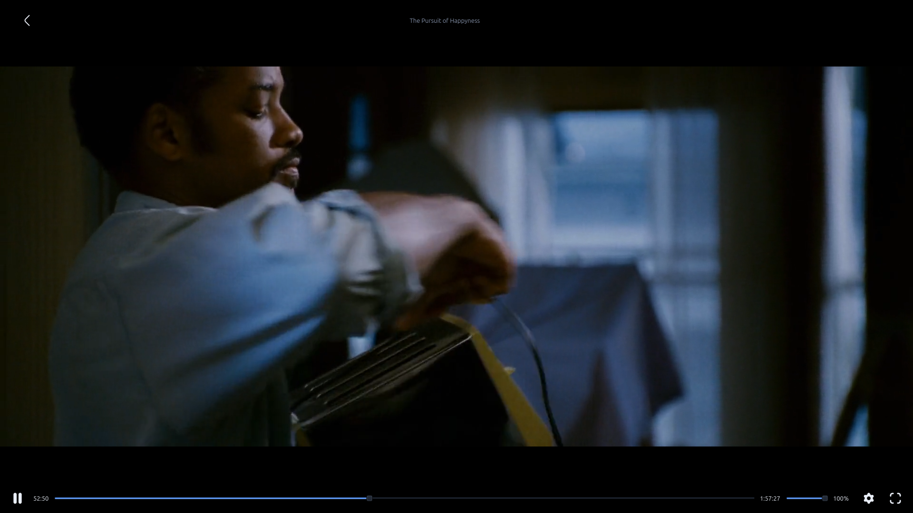
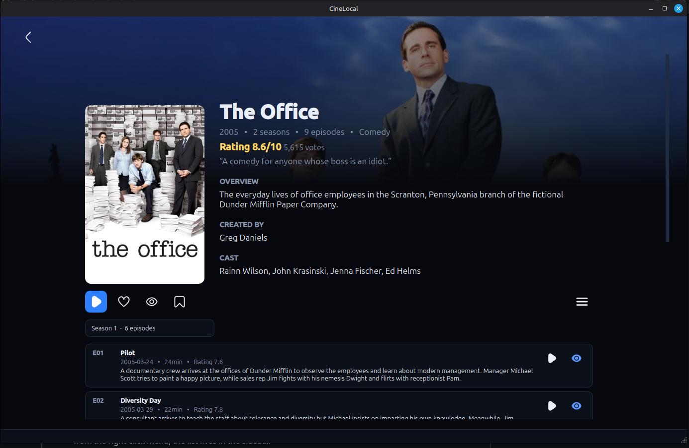
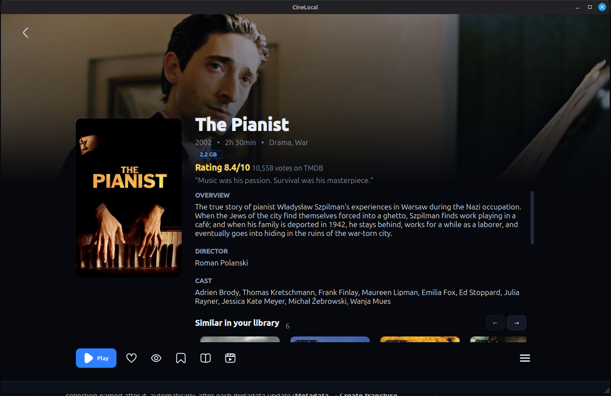
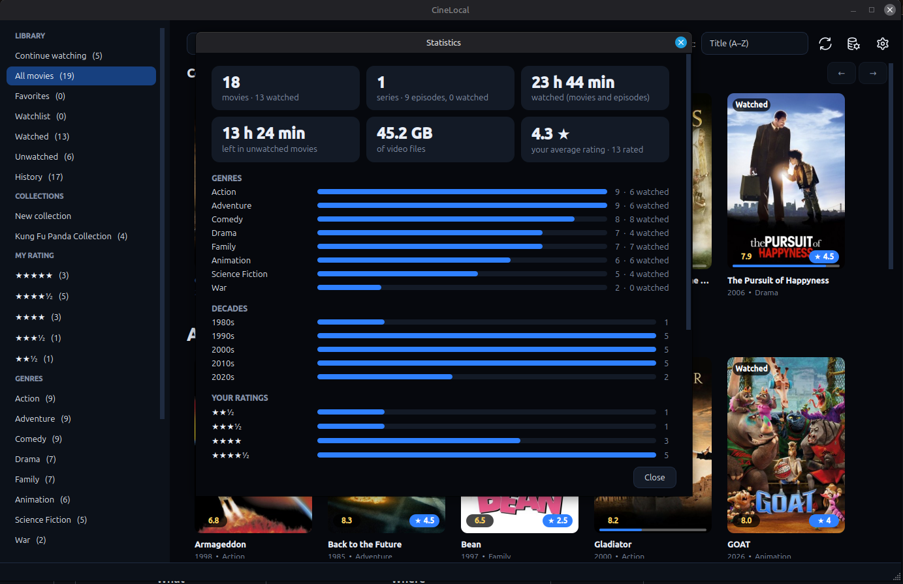

# CineLocal

Local movie browser for Linux and Windows.
Fast and offline: the internet is only used to download posters and metadata for new movies
(or when you force an update) and, if you set an OpenSubtitles key, their subtitles.



## Download and install (no Python or VLC needed)

Get just the file for your system from the [latest release](../../releases/latest) (no need for the source zip):

- **Windows 10/11**: `CineLocal-windows-x86_64-setup.exe` — double-click it and follow the wizard (no administrator
  rights; adds CineLocal to the Start Menu). Windows SmartScreen may warn about an unknown publisher:
  *More info → Run anyway*.
- **Linux Mint / Ubuntu / Debian (x86_64)**: `CineLocal-linux-x86_64.deb` — double-click it (Software Manager) or run
  `sudo apt install ./CineLocal-linux-x86_64.deb`. It installs the few system libraries it needs.
- **Portable, no installation** (other distros too): `CineLocal-windows-x86_64-portable.zip` or
  `CineLocal-linux-x86_64-portable.tar.gz` — extract anywhere and run the `CineLocal` file inside the folder.
  On Linux you may need `sudo apt install libxcb-cursor0`.

The built-in player is already included. The app is a folder (not a single file) on purpose: a single file would have
to unpack itself to a temporary folder on every launch, which makes it slow to open.

### Publishing a release (maintainers)

1. `git tag v<version> && git push --tags` — GitHub Actions builds the app with PyInstaller (`cinelocal.spec`, with
   VLC bundled) and attaches to a new release the Windows installer (`installer/cinelocal.iss`, Inno Setup), the
   Linux `.deb` (`packaging/build-deb.sh`) and the two portable archives.
2. To build locally instead: install VLC (set `VLC_DIR` if it is not in the default place), then
   `pip install pyinstaller && pyinstaller --noconfirm cinelocal.spec` (the app folder is `dist/CineLocal/`).
   Then `packaging/build-deb.sh <version>` (Linux) or `iscc /DAppVersion=<version> installer\cinelocal.iss`
   (Windows, with Inno Setup installed).

## Installation from source (Linux Mint / Ubuntu / Debian)

```bash
unzip cinelocal.zip && cd cinelocal
chmod +x *.sh   # some zip extractors lose the executable permission
./install.sh
```

The script installs any missing system libraries (it asks for the administrator password),
creates a virtual environment with PySide6 and adds **CineLocal** to the application menu.
To remove it: `./uninstall.sh` (`--purge` also deletes the data).

## Installation from source (Windows 10/11, needs Python)

1. Install **Python 3.10 to 3.12** from [python.org/downloads/windows](https://www.python.org/downloads/windows/),
   checking **"Add python.exe to PATH"** in the installer.
2. Extract the CineLocal zip and double-click **`install.bat`** (or run `install.bat` in Command Prompt,
   inside the extracted folder).
3. To use the **built-in player**, also install 64-bit [VLC](https://www.videolan.org/vlc/)
   (`winget install VideoLAN.VLC`). Without it, CineLocal opens the movie in the Windows default player.
4. Open **CineLocal** from the Start Menu.

The script copies the app to `%LOCALAPPDATA%\Programs\cinelocal`, creates a virtual environment with PySide6
(needs internet, ~200 MB) and adds the Start Menu shortcut. It does not need administrator rights.
To remove it: `uninstall.bat` (`--purge` also deletes the data).

## Uninstalling

Your movies are **never deleted**: the uninstaller only removes the app and, if you ask, CineLocal's data.

### Installed from the Windows installer / `.deb`

- **Windows**: *Settings → Apps → CineLocal → Uninstall*. At the end it asks whether to also delete the library,
  posters and settings.
- **Linux**: `sudo apt remove cinelocal` (or the Software Manager). Your data stays in your home folder; to delete it
  too (library, posters, API key and saved positions, with no way back):
  `rm -rf ~/.config/cinelocal ~/.local/share/cinelocal ~/.cache/cinelocal`
- **Portable version**: just delete the folder. To also remove the data, delete the same data folders: on Windows
  `%APPDATA%\cinelocal` and `%LOCALAPPDATA%\cinelocal` (paste each one in the File Explorer address bar).

### Linux

1. Open a terminal in the extracted CineLocal folder (the same one as `install.sh`).
2. If you see `Permission denied`, make the script executable (some zip extractors lose that permission):

   ```bash
   chmod +x uninstall.sh
   ```

3. **Uninstall** — removes the app, the menu shortcut and the icon, but keeps the library, posters and settings
   (if you reinstall later, everything stays as it was):

   ```bash
   ./uninstall.sh
   ```

4. **Purge** (optional) — also removes all data. This deletes the library, the cached posters, the API key
   and the saved "Continue watching" positions, and cannot be undone:

   ```bash
   ./uninstall.sh --purge
   ```

   Folders removed by the purge: `~/.config/cinelocal`, `~/.local/share/cinelocal` and `~/.cache/cinelocal`.

### Windows

1. Open Command Prompt in the extracted CineLocal folder (the same one as `install.bat`). No `chmod`
   or administrator rights needed.
2. **Uninstall** — removes the app and the Start Menu shortcut, keeping the data:

   ```bat
   uninstall.bat
   ```

3. **Purge** (optional) — also removes the library, posters, API key and saved positions, with no way back:

   ```bat
   uninstall.bat --purge
   ```

   Folders removed by the purge: `%APPDATA%\cinelocal` and `%LOCALAPPDATA%\cinelocal`.

## Getting started

1. Open the app and click **Select movies folder** (the folder is read recursively).
2. Paste your **free TMDB key**: create an account at themoviedb.org → Settings → API →
   copy the "API Key" (or the "Read Access Token"). Use **Test** to validate it.
3. The app identifies each file by its name (ignoring `1080p`, `BluRay`, `[YTS]`... and using the year, if present),
   downloads the poster, synopsis, rating, cast, etc. in the background and stores everything locally.

## Usage

- **All movies** (default screen): rows above the grid (← → arrows to move through the movies) that
  disappear when empty or while searching, and scroll together with the grid. Use **Edit home** (in Settings) to choose
  which rows appear — *Continue watching*, *History*, *Favorites*, *Watchlist* and any of your collections —
  and in what order (by default only *Continue watching*).
- **Grid**: click a poster to open the details (in the same window; `←  Back`, `Esc` or `Alt`+`←` return to the list
  exactly where you were). `Ctrl`/`Shift`+click selects several movies;
  right-click opens the menu (favorite, watched, collections, tags, update, fix match). In details, use **More → More info**
  for file size, budget, box office, production countries and companies, languages, franchise and other TMDB data.
  Each movie can have multiple colored tags; add or remove them from details or the grid menu and change their color
  from a tag's context menu. Click a tag on a movie's details page to filter the library to that tag.
- **Instant search** (`Ctrl+F`) by title, actor, director or genre; **sorting** by title, year,
  rating, popularity, vote count, runtime or recently added (ascending and descending where applicable).
- **Advanced search** (magnifier button next to the search box): opens a panel where you combine any
  of the filters below; only the ones you fill in count, and a movie must match all of them. It works
  on the data already saved locally, on top of the section selected in the sidebar. The button shows
  how many results you will get; **Show results** applies it and a bar with **Clear search** appears
  above the grid to go back to the whole catalog. Use **Save…** to keep the current filters under a
  name and load them again from the “Saved filters” list next time.
  - Content: movies or series, runtime (the runtime limits only apply to movies; series are not filtered by it).
  - Release and ratings: year (a range or a single year), TMDB rating and number of votes.
  - Genre (any or all of the chosen ones) and age rating.
  - Production countries, spoken languages and movie tags.
  - People: directors and cast, picked from the ones in your library.
  - My library: watched/unwatched, favorites, watchlist, in progress, your collections, your tags, your own
    star ratings and how recently the movie was added.

  Number fields accept typed values, the ▲▼ buttons or preset values from the ▾ menu; lists have
  *Select all* and *Clear*. Age ratings are downloaded with the metadata (use *Force update* on
  existing movies).

  
  
- **Sidebar**: All, Favorites, Watched/Unwatched, **Collections** (a movie can be in several),
  **Tags** (below Collections), Genres and Years (decades). Click a tag to view its movies; right-click it to
  edit its name and color and select which movies belong to it. Right-click a collection to rename or delete it. **History** lists
  everything you have watched, or started to watch, with the most recent first (movies marked as
  watched before the dates were recorded come last).
- **Watch** opens the **built-in player** (based on libVLC): `Space` pauses, `←`/`→` skip 10 s, `↑`/`↓` change the
  volume, `M` toggles mute, `F` toggles fullscreen and `Esc` goes back. It needs VLC installed (on Linux `install.sh` installs it) and,
  on Linux, X11 or XWayland (Wayland sessions run through XWayland automatically; a pure Wayland session without XWayland is not supported). Without that, or if you set a player in Settings (e.g. `mpv --fs`),
  the movie opens in the external player (`xdg-open` on Linux, the associated program on Windows).
  Past 95% the movie is marked as watched; at the end of an episode, the player offers the next one (and in series, the **▶|** button next to pause skips to it). On the grid, a
  bar on the poster shows how much has been watched, and **Continue watching** (sidebar) gathers what is half-watched
  (series included, with the episode in progress); "Watch from the start" is in the right-click menu.
  Volume and picture adjustments are remembered between movies; the player's gear (⚙) also has **speed** (0.5x to 2x) and **subtitle
  delay**, and the progress bar shows the time at the point under the mouse.
  In Settings you choose the **default player** (built-in or external); right-click a movie (or use the player's ⚙ gear)
  to open it in the other one. The built-in player remembers where you stopped and resumes from there, even after closing the app.
  In the player, the **⚙** gear gathers **Audio** and **Subtitles** (tracks that come in the file) and **Picture**
  (brightness, contrast, color and sharpness). In fullscreen, the controls and the pointer disappear after a few seconds without moving the mouse.

  
  
- **Series**: files with `S01E02`, `1x02` or `Season 1 Episode 2` in the name (or inside `Season N` folders)
  are grouped under a single series poster, which opens the list of seasons and episodes, each with its own metadata.
  (Portuguese names such as `Temporada 1 Episódio 2` are recognized too.)
  Series appear with a “Series” badge on the grid and are left out of collections.

  
  
- **Watchlist**: movies you want to watch in the future. Add them with the `Watchlist` button in the details or from the
  right-click menu; the list lives in the sidebar.  
  
  
- **Similar movies**: the details of a movie end with a row of movies from your library that resemble it (genres,
  director, cast, franchise and era). It works offline, from the metadata already saved.
- **Franchises**: movies that belong to the same TMDB franchise (2 or more in your library) are put into a collection
  named after it, automatically, after each metadata update (**Metadata → Create franchise collections** runs it on
  demand). A movie is linked once, so taking it out of the collection by hand sticks. Movies that already have
  metadata need a **Force update** the first time, to learn their franchise.
- **File badges**: the details show the resolution, video codec, audio and size of the file (`1080p`, `H.264`,
  `AC3 5.1`, `2.1 GB`). They are read from the files in the background with libVLC (no extra install).
- **Duplicates** (**Metadata → Find duplicate files…**): lists movies and episodes that exist in more than one file,
  with size and quality side by side, and opens the folder of each so you can delete the ones you don't want.
- **Statistics** (**Metadata → Statistics…**): movies, series and episodes, time watched and left to watch, library
  size, your average rating, and the most common genres, decades, directors and actors.

  
  
- **Rescan** (`F5`): runs when the app opens; detects new movies and removes the ones that disappeared from disk.
  Files moved to another subfolder keep their metadata, collections and flags.
- **Edit metadata**: in the details of a movie or series, **⋮ → Edit metadata…** changes the title, year, runtime, genres,
  director, tagline, overview and cast, and lets you pick your own cover image. What you edit (and the cover) is kept when
  the metadata is updated; **Reset to original…** discards your edits and downloads the metadata again.
- **Metadata**: fetch pending items, force an update of all (keeps confirmed matches)
  or review movies without a match. When the app is not sure (remakes, ambiguous title, nothing
  found), the movie gets a **Review** badge and you pick the right one in a dialog.
- **Automatic subtitles** (optional): paste a free [OpenSubtitles](https://www.opensubtitles.com/en/consumers) API key in
  Settings and the subtitle of every new movie or episode is downloaded in the background, in the **Subtitle language**
  (or the metadata language, if that is left on "File default"). It is saved next to the video (`Movie.pt-BR.srt`), so it
  loads every time you watch it again, in any player. Videos that already have a subtitle are skipped. The free account has a
  daily download limit: what is left waits and is downloaded on the next scan.
- Metadata **language**: default `en-US` (English is used as a fallback when a translation is missing);
  change it in Settings.

## Where the data lives

| What | Where |
|---|---|
| Library, collections, flags (SQLite) | `~/.local/share/cinelocal/library.db` |
| Posters, thumbnails and backdrops | `~/.cache/cinelocal/images/` |
| Settings (includes the TMDB key) | `~/.config/cinelocal/settings.json` (permission 600) |

On Windows: library in `%LOCALAPPDATA%\cinelocal\library.db`, posters in `%LOCALAPPDATA%\cinelocal\cache\images\`
and settings in `%APPDATA%\cinelocal\settings.json`.

Your video files are never modified.

## Code structure

```
main.py                     entry point
cinelocal/
  config.py                 paths, extensions, settings (JSON)
  db.py                     SQLite: movies, collections, flags
  scanner.py                folder scanning and filename cleanup
  library.py                syncs disk ↔ database (new, removed, moved)
  similar.py                similar movies from the saved metadata
  franchises.py             which movies go into which franchise collection
  duplicates.py             the same movie or episode in more than one file
  mediainfo.py              resolution/codecs of a file (libVLC) and the badges
  stats.py                  numbers for the statistics page
  tmdb.py                   TMDB HTTP client
  opensubtitles.py          OpenSubtitles HTTP client: finds and saves subtitles next to the videos
  parsing.py                parses responses and picks the best match
  metadata_service.py       identifies the movie, downloads metadata and images
  images.py                 poster/thumbnail/backdrop cache
  workers.py                threads (parallel updates, background tasks)
  service.py                in-memory state + operations used by the interface
  filters.py                filters, advanced search, sorting and counts
  player.py                 opens the movie in the external player
  ui/                       theme (QSS), grid, sidebar, windows and dialogs
  ui/player_page.py         built-in player (libVLC)
  ui/advanced_search.py     advanced search panel (overlay)
  ui/home_dialog.py         “Edit home”: rows of the home screen
  ui/edit_dialog.py         manual editing of metadata and cover
  ui/duplicates_dialog.py   list of duplicate files
  ui/stats_dialog.py        statistics page
tests/test_core.py          tests for the logic without a GUI
```

Tests: `python3 -m unittest discover -s tests`

## Notes

- This product uses the TMDB API but is not endorsed or certified by TMDB.
- Recognized formats: mkv, mp4, avi, mov, wmv, m4v, webm, flv, ts. To change them, edit `VIDEO_EXTENSIONS`
  in `cinelocal/config.py`.
